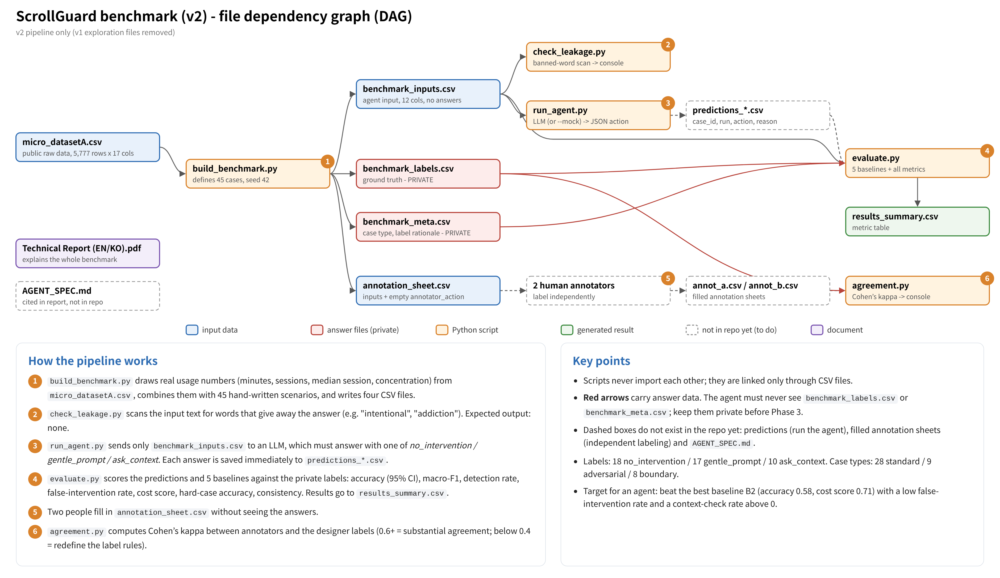
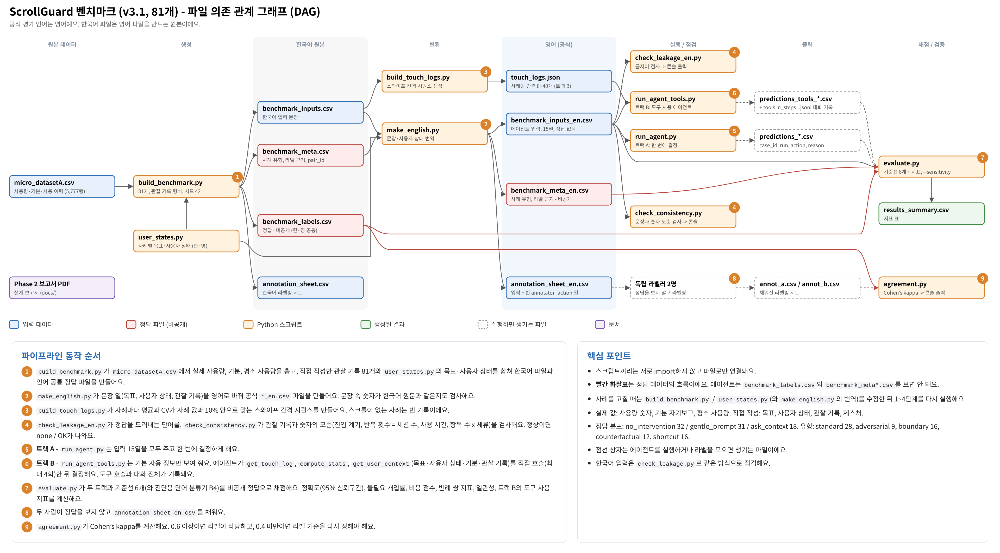

# ScrollGuard Agent Benchmark

An evaluation benchmark for **ScrollGuard**, an intent-aware agent that breaks the cycle of mindless scrolling. Unlike lock apps that block by usage time alone, ScrollGuard should read the usage context, leave intentional use alone, and step in gently only when the user is scrolling on autopilot.

The benchmark measures one decision: given a smartphone-usage situation, **should the agent intervene now?**

> Special Topics on Generative AI (Agentic AI), Phase 2 · version 3.1 · 81 cases
>
> Reports: [English](docs/ScrollGuard_Phase2_Benchmark_EN.pdf) · [한국어](docs/ScrollGuard_Phase2_Benchmark_KO.pdf)

---

## 1. Task

For each case the agent returns one line of JSON:

```json
{"action": "no_intervention | gentle_prompt | ask_context", "reason": "1-2 sentences"}
```

| Action | Meaning | Labeling rule |
|---|---|---|
| `no_intervention` | Intentional or normal use. Do nothing. | Behavior matches the stated goal, or goal-directed actions are observed (search, save, write, pay, switch to a related app); short utility use; use within a self-set limit. Long usage alone is not a reason to intervene. |
| `gentle_prompt` | Autopilot use. Fade the screen to grayscale and show a small pop-up or TTS check-in; the user can always continue. | Two or more independent autopilot signals and no counter-evidence (no goal-directed action, drifting into a feed after a notification, passing a stated goal / timer / bedtime goal, schedule conflict, repeated rechecking). |
| `ask_context` | Ask what the user is trying to do first. | Purpose and drift signals conflict, or key information is inaccessible while usage is notable. |

### Two tracks

| Track | Agent | Script |
|---|---|---|
| **A. One-shot decision** | Receives all 15 input columns and decides once. | `run_agent.py` |
| **B. Touch track (tool-using agent)** | Starts with time, entry trigger, app type and usage numbers only. Gathers the rest with tools (max 4 calls): `get_touch_log` (swipe intervals, speed, direction), `compute_stats`, `get_user_context` (goal, user state, mood, observation log). The trajectory is logged and scored. | `run_agent_tools.py` |

The benchmark evaluates the **decision layer**. The observation log is assumed to be the output of a sensing layer (usage stats, notification listener, accessibility events, calendar) that already works.

## 2. Data

81 cases: 32 `no_intervention`, 31 `gentle_prompt`, 18 `ask_context`.

| Case type | Count | Purpose |
|---|---|---|
| standard | 28 | Typical cases |
| adversarial | 9 | Wrong if only usage time, sessions or concentration are used |
| boundary | 16 | Mixed signals or blocked information |
| counterfactual | 12 | 6 pairs with the same context and opposite gestures (same label) |
| shortcut | 16 | Against single-cue shortcuts (dwell, CV, goal presence, app type, late night, ...) |

**Input columns (15)** in `benchmark_inputs_en.csv`

| Group | Columns |
|---|---|
| Situation | `time_of_day`, `entry_trigger`, `app_type` |
| User | `user_stated_goal`, `user_state`, `self_reported_mood` (real), `typical_usage_minutes` (real) |
| Observation log | `recent_context`: `Entry \| In app \| App switches \| Interactions \| Schedule/settings` |
| Usage and gestures | `usage_minutes`, `usage_sessions`, `median_session_sec`, `usage_quadratic` (all real), `swipe_interval_cv`, `avg_dwell_sec` |

Real values come from the public dataset `micro_datasetA.csv` (5,777 rows). Goals, user states, observation logs and gestures are written to follow the labeling rules. English is the official language; Korean files are the source they are generated from.

## 3. Metrics and success criteria

| Metric | Definition |
|---|---|
| accuracy (95% CI), macro-F1, confusion matrix | Overall performance |
| detect_rate | `gentle_prompt` cases answered correctly |
| **false_intervention** | `no_intervention` cases answered with `gentle_prompt` (core product metric) |
| question_burden, ask_recall | Unneeded questions; correct questions on unclear cases |
| cost_score | 1 − mean error cost (unneeded intervention 1.0, unneeded question 0.8, miss 0.8, ...) with `--sensitivity` over 4 weight sets |
| hard_acc | Accuracy on adversarial, boundary and counterfactual cases |
| pair_both_correct, gesture_flip | Counterfactual pairs: both correct / decision changed when only the gesture changed |
| invalid_rate, consistency | Malformed outputs; same answer across 3 runs |
| Tool metrics (track B) | context/touch check rate, tool calls, accuracy with vs. without checking context |

**Baselines** (English inputs)

| Baseline | Accuracy | False intervention | Cost score |
|---|---|---|---|
| B0 always `no_intervention` | 0.40 | 0.00 | 0.56 |
| B1 intervene at 30+ minutes | 0.41 | 0.41 | 0.54 |
| B2 feature rule, no text | **0.51** | 0.06 | **0.64** |
| B3 swipe CV < 0.6 | 0.49 | 0.38 | 0.61 |
| B4 word classifier (diagnostic, trained on labels) | 0.60 | 0.44 | 0.69 |

An agent meets the goal when it beats B2 on accuracy and cost score, keeps false_intervention low (target ≤ 0.10), asks on unclear cases (ask_recall > 0), beats B3 on counterfactual pairs, and stays valid and consistent. See the report for the full criteria.

## 4. Quick start

```bash
pip install pandas numpy openai anthropic
```

```bash
python check_leakage_en.py
python check_consistency.py
```

Track A with a local model (LM Studio, OpenAI-compatible server):

```bash
python run_agent.py --lang en --inputs benchmark_inputs_en.csv --model exaone-3.5-7.8b-instruct --base-url http://localhost:1234/v1 --runs 3 --out predictions_A.csv
```

Track B with the Anthropic API (`ANTHROPIC_API_KEY` must be set):

```bash
python run_agent_tools.py --lang en --inputs benchmark_inputs_en.csv --provider anthropic --model claude-sonnet-5-5 --runs 3 --out predictions_B.csv
```

Score both against the six baselines:

```bash
python evaluate.py --inputs benchmark_inputs_en.csv --meta benchmark_meta_en.csv --pred predictions_A.csv predictions_B.csv --confusion --sensitivity
```

Label agreement of two independent annotators:

```bash
python agreement.py annot_a.csv annot_b.csv
```

Add `--resume` to a run command to continue after an interruption; failed calls are retried. `--mock` checks the pipeline without a model.

### Evaluating your own agent

Submit a CSV with the columns `case_id, run, action, reason` (one row per case and run) and pass it to `evaluate.py --pred`. Track B files may add `tools` and `n_steps`.

## 5. Files



| File | Role |
|---|---|
| `build_benchmark.py`, `user_states.py` | Build the 81 cases (Korean source, labels, meta, annotation sheet) |
| `make_english.py` | Generate the official English files |
| `build_touch_logs.py` → `touch_logs.json` | Swipe intervals, speed and direction for track B |
| `benchmark_inputs_en.csv` | Agent input |
| `benchmark_labels.csv`, `benchmark_meta_en.csv` | Labels and case metadata (**never give these to an agent**) |
| `check_leakage_en.py`, `check_consistency.py` | Answer-leak check; text vs. number consistency check |
| `run_agent.py`, `run_agent_tools.py` | Track A and track B runners (local or Anthropic, `--mock`) |
| `evaluate.py` | Baselines, metrics, confusion matrices, cost sensitivity |
| `agreement.py`, `docs/annotation/` | Cohen's kappa; annotation guide ([EN](docs/annotation/annotation_guide_en.pdf), [EN/KO](docs/annotation/annotation_guide.pdf)) and blank sheets |
| `docs/` | Reports, file graphs (`file_graph_en.png`, `file_graph_ko.png`) |

To change a case, edit `build_benchmark.py` / `user_states.py` (and the translation in `make_english.py`), then rerun `build_benchmark.py`, `make_english.py`, `build_touch_logs.py` and the two checks.

## 6. Limitations

- Labels are the designers' judgment until validated by two annotators (Cohen's kappa).
- Only usage numbers, mood and typical usage are real; other signals are written or generated, and the sensing layer is assumed perfect.
- 81 cases give a ±0.1 accuracy CI; smaller differences are not interpreted.
- Error costs are design assumptions; report them with the sensitivity analysis.

---

## 한국어 요약

ScrollGuard는 사용 시간만 보고 막는 잠금 앱과 달리, 맥락을 읽어 **의도적 사용은 방해하지 않고 무의식적 스크롤일 때만 부드럽게 개입**하는 에이전트예요. 이 벤치마크는 사용 상황 81개를 보고 `no_intervention`(개입 안 함) / `gentle_prompt`(흑백 전환과 작은 팝업·TTS 확인) / `ask_context`(먼저 묻기) 중 무엇을 고르는지 평가해요.

- **트랙 A:** 입력 15열을 모두 보고 한 번에 결정 (`run_agent.py`)
- **트랙 B:** 도구로 터치 기록과 맥락을 직접 조회한 뒤 결정 (`run_agent_tools.py`)
- **채점:** `evaluate.py`가 기준선 6개와 함께 정확도, 불필요 개입률, 비용 점수, 반례 쌍 지표, 도구 사용 지표를 계산해요.
- **라벨 검증:** 라벨러 2명이 [안내문](docs/annotation/annotation_guide.pdf)을 보고 시트를 채우면 `agreement.py`로 kappa를 계산해요.
- **자세한 설명:** [한국어 보고서](docs/ScrollGuard_Phase2_Benchmark_KO.pdf), 파일 관계는 아래 그림을 참고하세요.


